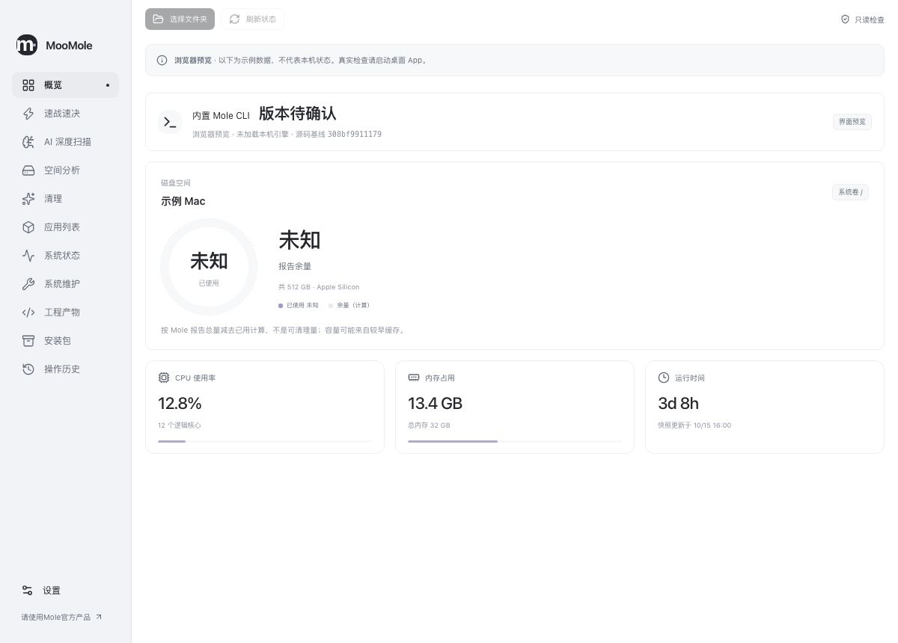
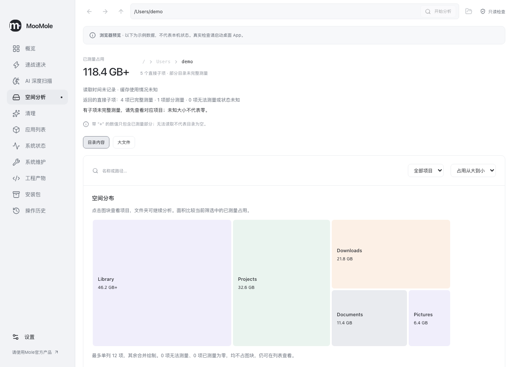
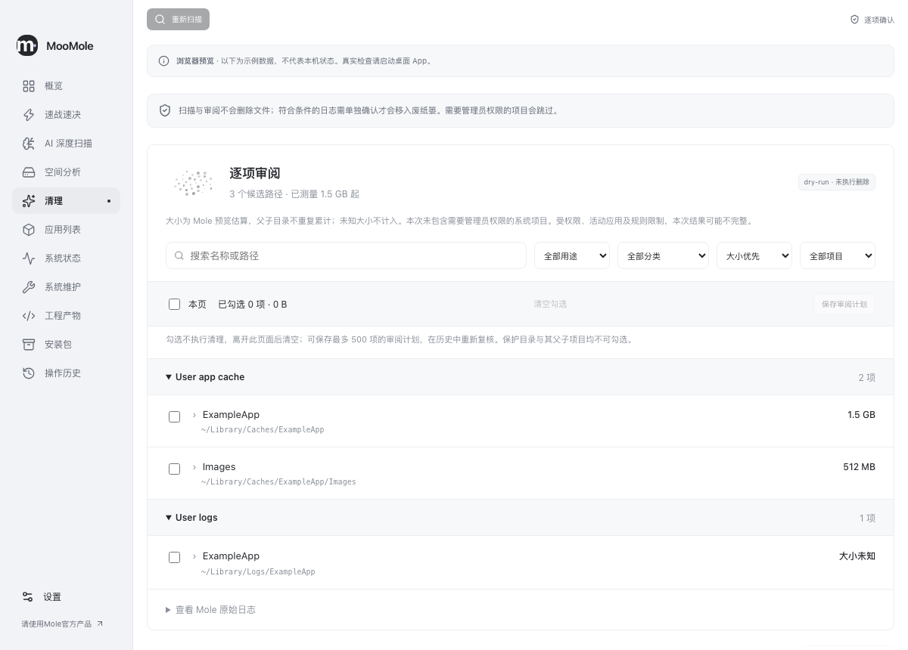
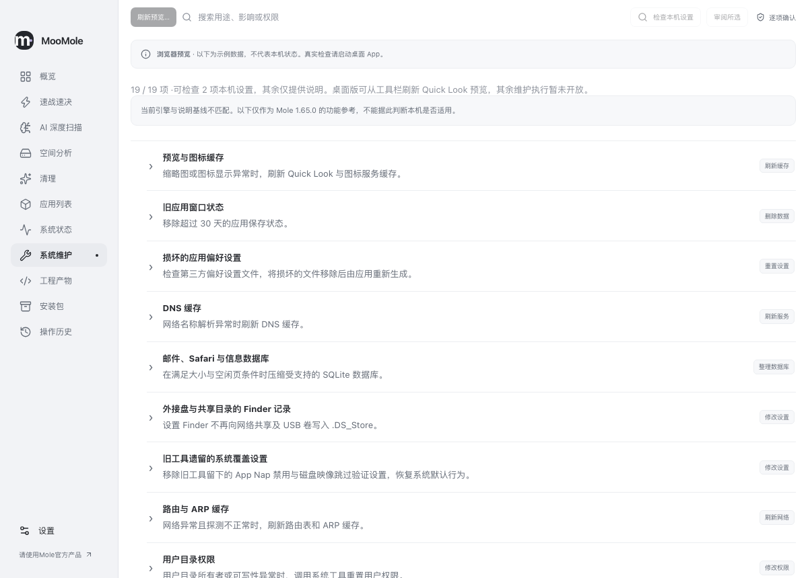
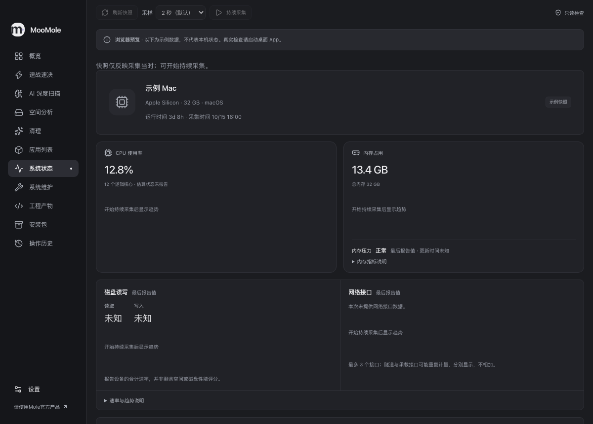

<p align="center">
  
</p>

<h1 align="center">MooMole</h1>

**English** · [简体中文](README.zh-CN.md) · [日本語](README.ja-JP.md)

An unofficial macOS graphical client for Mole CLI, with more approachable workflows built on its capabilities. Keep it simple: see the result, understand the impact, then choose the next action. Built with React + Vite + TypeScript + Tauri + SQLite.

> This independent, unofficial project is for learning and research only. Understand the effects of each operation and back up important data before use. You assume the risks and any resulting issues.
>
> Some features build on [Mole CLI](https://github.com/tw93/Mole). Thanks to its author and contributors. Please respect and support their work by choosing the [official Mole product](https://mole.fit/) for everyday use.

## Screenshots

Current interface in Simplified Chinese, captured from the browser preview with sample data. These images do not represent a scan of this Mac or release acceptance. Click an image to view it at full size.



| Space analyzer | Cleanup review |
| --- | --- |
| [](docs/screenshots/space-analysis.png) | [](docs/screenshots/cleanup.png) |
| **System maintenance** | **System status · Dark theme** |
| [](docs/screenshots/maintenance.png) | [](docs/screenshots/system-status-dark.png) |

Brand assets: [SVG icon](src/assets/icon.svg) · [Logo](src/assets/logo.svg) · [Logo for dark backgrounds](src/assets/logo-dark.svg). See [usage notes](docs/brand-assets.md).

## Languages

The interface supports Simplified Chinese, English and Japanese. Switch at any time in **Settings → General → Interface language**, without restarting. First launch follows the system’s primary preferred language; other system languages fall back to English. Manual choices are saved locally across restarts, and you can return to **Follow system**. Paths, original logs and diagnostic evidence retain their original text. Detailed development documents are currently mainly in Chinese.

## Current status

<!-- release:start -->

Latest published version: **[0.2.0](https://github.com/rememberber/MooMole/releases/tag/v0.2.0)** (2026-10-29), bundled with **Mole CLI 1.65.0**. This learning and research release includes real cleanup, app uninstall and Quick Look maintenance within the limits below. Full permission/fault, installation/upgrade and corresponding-source/license acceptance remains incomplete; see [execution acceptance](docs/first-release-execution.md) and the release notes.

New in 0.2.0: quick cleanup with verified user-cache execution, AI deep scan through local agents, Chinese/English/Japanese switching, restored window dragging and restrained task animations. The [release notes](https://github.com/rememberber/MooMole/releases/tag/v0.2.0) are available in English, Simplified Chinese and Japanese.

<!-- release:end -->

| Feature | What you can do in 0.3.0 |
| --- | --- |
| Cleanup | Run [full Mole cleanup](docs/mole-clean-parity.md) from the disk overview after confirming its scope. It permanently deletes eligible items and can empty Trash. Use [item-by-item review](docs/quick-cleanup.md) to move supported caches and logs to Trash. |
| Software cleanup and AI | Review files from supported browsers, Mail and selected media exports. Optional [AI deep scan](docs/ai-deep-scan.md) uses an installed Codex CLI or Claude Code agent and requires consent before sharing selected metadata with its model service. Suggestions go through the same review. See [software cleanup](docs/software-cleanup.md). |
| Space and personal files | Explore folders and mounted volumes, check cloud-file storage, preview files, and confirm moves, archives or Trash actions. Review exact duplicates and compare similar photos and videos before selecting what to keep. See [personal files](docs/personal-files.md). |
| Applications | Inspect, open, quit or uninstall supported apps. Review compatible updates and retain the previous bundle when replacing an eligible app. Supported Homebrew Casks have their own upgrade and uninstall confirmation. See [application updates](docs/application-updates.md) and [managed apps](docs/managed-apps.md). |
| Maintenance | Refresh Quick Look, submit a selected folder for Spotlight indexing, or re-register a selected app. Other maintenance items may offer inspection or reference information. See [problem-based maintenance](docs/problem-repairs.md). |
| Archives and recovery | Create ZIP archives, review ZIP and TAR extraction, and restore eligible files or retained app versions from verified records. Export execution records for later review. See [file restoration](docs/file-restoration.md), [ZIP extraction](docs/zip-extraction.md) and [execution archives](docs/execution-archive.md). |
| Ongoing management | Observe system and storage trends. Opt in to menu-bar monitoring, low-space reminders, login startup and scheduled folder workflows. See [storage monitoring](docs/storage-monitor.md) and [scheduled file processing](docs/scheduled-files.md). |

Start with [first use](docs/first-use.md). See [product direction](docs/product-direction.md) and [release roadmap](docs/release-roadmap.md) for the full capability map and remaining scope. The home page shows the actual bundled Mole CLI version and engine state. Browser previews use sample data only.

Moving to Trash does not immediately free space. Cancellation stops only work not yet started; existing outcomes remain. Unverified results are not retried automatically. To retrieve an item, verify the real object and original folder in Finder and avoid overwriting existing files. Client protection and Mole allowlists remain in force; unknown or restricted conditions are never relaxed to obtain success.

## Installation and updates

<!-- downloads:start -->

Download the architecture-matched **0.2.0** DMG below. Packages use free ad-hoc signing; they do not have Apple Developer ID signing or notarization. A paid Apple developer account is not required.

| Mac | Download |
| --- | --- |
| Apple Silicon (`arm64`) | [MooMole 0.2.0 DMG](https://github.com/rememberber/MooMole/releases/download/v0.2.0/MooMole-0.2.0-mac-arm64.dmg) |
| Intel (`x64`) | [MooMole 0.2.0 DMG](https://github.com/rememberber/MooMole/releases/download/v0.2.0/MooMole-0.2.0-mac-x64.dmg) |

Check the chip/processor in [About This Mac](https://support.apple.com/guide/mac-help/mchlea7173f3/mac). Verify file size and SHA-512 on the [release page](https://github.com/rememberber/MooMole/releases/tag/v0.2.0) or against [SHA512SUMS](https://github.com/rememberber/MooMole/releases/download/v0.2.0/SHA512SUMS), open the DMG, copy the app to Applications, then launch from that location. Matching source, dependency materials and validation manifests are in each architecture’s `materials.zip` on the release page.

<!-- downloads:end -->

On first open, macOS may warn that the developer or malicious-software status cannot be verified. Confirm the source and integrity, then decide using [Apple’s security guidance](https://support.apple.com/102445). The app never disables Gatekeeper or strips system security attributes. Updates follow **Settings → About → Check for updates → Download and verify size/SHA-512 → Open DMG → Quit normally and replace manually**. A running app is never silently replaced. Checking does not generate packages when no new release exists.

Release workflows build and verify both architectures and provide matching materials. Native Intel interaction, first open after a quarantined public download and the full cross-version installation and permissions matrix remain pending. See [distribution](docs/distribution.md) and the [0.2.0 validation record](docs/releases/0.2.0.md).

## Local development

Build target: macOS 14+. Actual native interaction acceptance has mainly used an Apple Silicon development Mac; the target does not establish minimum-OS or Intel acceptance.

Requires Node.js 24+, npm, Rust, Go and Xcode Command Line Tools. Pinned versions are in [build validation](docs/build-validation.md). Scripts prefer toolchains in project `.cache/` without changing shell configuration. A fresh clone still needs tool setup.

```sh
npm ci
npm run engine:prepare
npm run desktop

# Browser samples only; no local data access
npm run dev

# Build the latest local optimized App and report; no upload/publication
npm run build:local-app

# Also create, mount, verify and eject an architecture-matched ad-hoc DMG
npm run build:local-dmg
```

Latest output stays directly in `local-artifacts/` and replaces the previous successful build. DMG builds keep only the DMG and report; append `-- --zip` when a ZIP is needed. Preview disposable workspace caches with `npm run clean:workspace`, or remove them with `npm run clean:workspace -- --apply`.

The engine is built from a pinned Git tree, checked for resources/architecture and published atomically. Failure retains the old engine. With caches present, append `-- --offline` to preparation/local-artifact commands. Running the app needs no development toolchain and never downloads or separately updates its bundled engine. See [engine preparation](docs/engine-integrity.md) and [local builds](docs/local-app-build.md).

## Checks

Edit the app version only in `package.json`, then run `npm run version:sync` to synchronize native and lock files. Common checks:

```sh
npm run version:check
npm run format:check
npm test
npm run build
npm run notices:prepare # Prepare licensing materials before native builds; Tauri wrapper does this automatically
npm run check:rust
npm run test:engine
npm run test:adapter
npx playwright install chromium
npm run test:e2e
```

Browser regression uses a separate port 1431 without reusing an existing server; override with `MOOMOLE_E2E_PORT=1432` if occupied. Development app uses 1420. Other version/artifact/source/licensing/candidate checks are in [build validation](docs/build-validation.md). Checks run independently of releases. As in MooTool, pushing a version tag starts parallel packaging, publishes the trilingual GitHub Release, then updates the feed and README download blocks automatically. See [release conventions](RELEASE_CONVENTIONS.md).

## Local data and recovery

Settings and records live in `~/Library/Application Support/io.github.rememberber.moomole/`, with database `moomole.sqlite`. Records may contain paths, check results, operation intent and Trash receipts, never file contents or administrator passwords. AI deep scans separately ask permission to send bounded file metadata to the chosen agent’s model service; other records are not uploaded automatically.

Task, scan and review history defaults to 30 days, with 7/90-day options. Execution evidence and unverified interruption evidence are not pruned with ordinary history. Execution workflows share admission and active-record limits. When full, new batches stop. In **Activity history → Archive…**, save complete records that have ended and received required review to free active capacity. Archives preserve original plans, results, receipts, events and verification marks, support export/read-only opening, and never restore execution permission. See [retention](docs/local-data-retention.md) and [execution archives](docs/execution-archive.md).

Database schema in 0.3.0 is v8 (0.2.0 uses v7). Upgrades from v1–v7 back up automatically; older apps should not open the new database directly. Interrupted changes do not resume automatically. Verify actual objects before recording verification of uncertain results; original unknown outcomes are not rewritten. No one-click database rollback or universal undo. See [upgrade and recovery](docs/native-upgrade-recovery.md).

The frontend exposes no general shell, arbitrary SQL or direct filesystem interface. Changes use a confirmation specific to the action and per-run validation. Updates access fixed sources without sending folders, history or diagnostics; see [update privacy and protocol](docs/update-check.md). Read-only checks may write local caches/check records; they do not imply zero local writes.

## Sources and license

Bundled Mole CLI baseline: **1.65.0** / [`308bf9911179ddfa40e5df9fdc42095a18ba5cfc`](https://github.com/tw93/Mole/commit/308bf9911179ddfa40e5df9fdc42095a18ba5cfc). Upstream sources are unchanged. Client adapters and UI sources are in this repository. Release materials provide the client, Mole, published dependencies and npm source inputs bound to the same app. Complete corresponding-source and release-license review remain pending; see [source bundles](docs/source-bundle.md) and [dependency materials](docs/dependency-materials.md).

Licensed under [GPL-3.0-only](LICENSE). See [Mole-LICENSE](third-party/Mole-LICENSE) and [third-party notices](third-party/NOTICE.md) for upstream licensing, provenance and build details. Mole names and brand assets belong to the original project. This project is neither official nor endorsed; the public name still requires confirmation under upstream branding policy.
