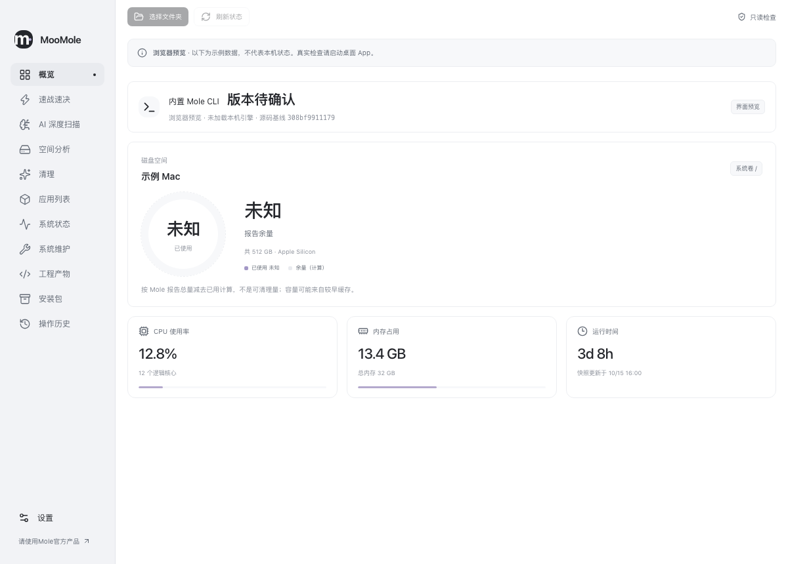
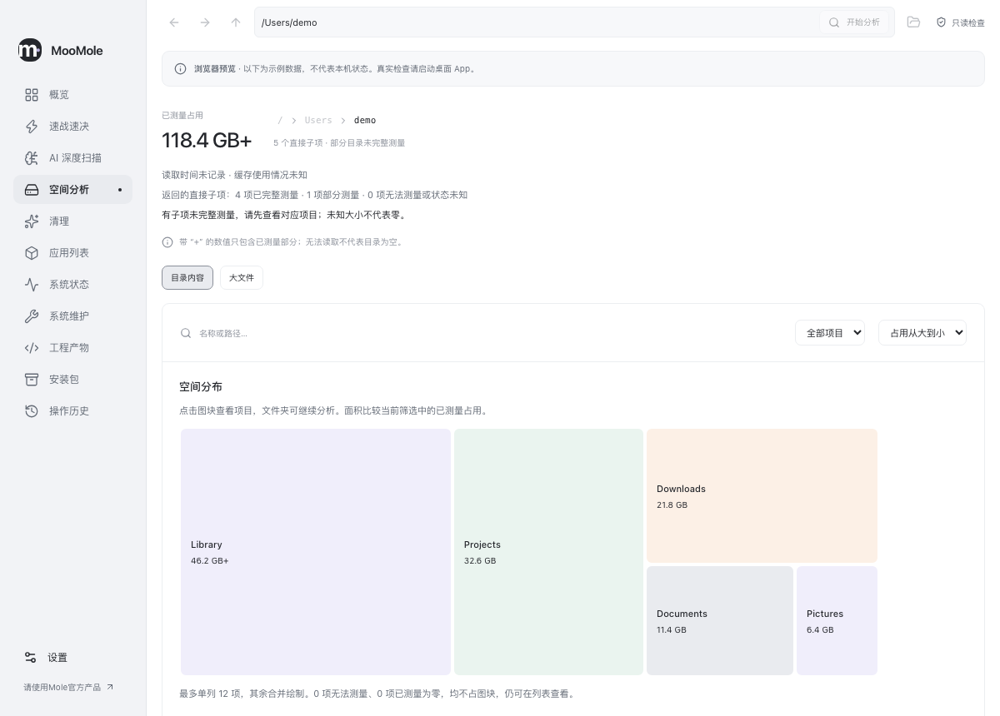
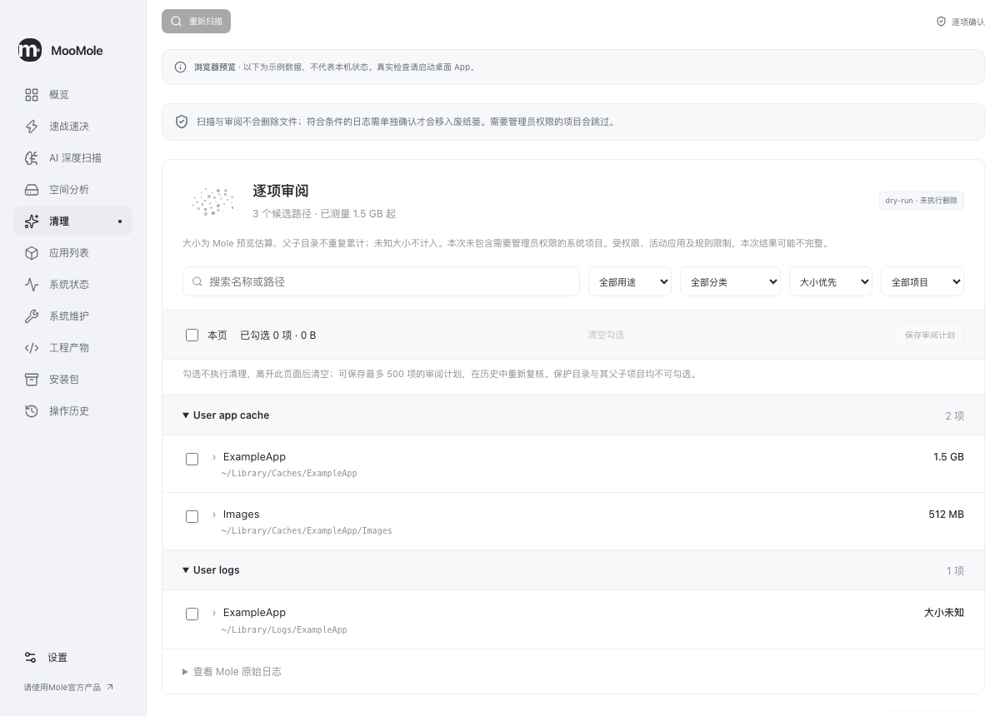
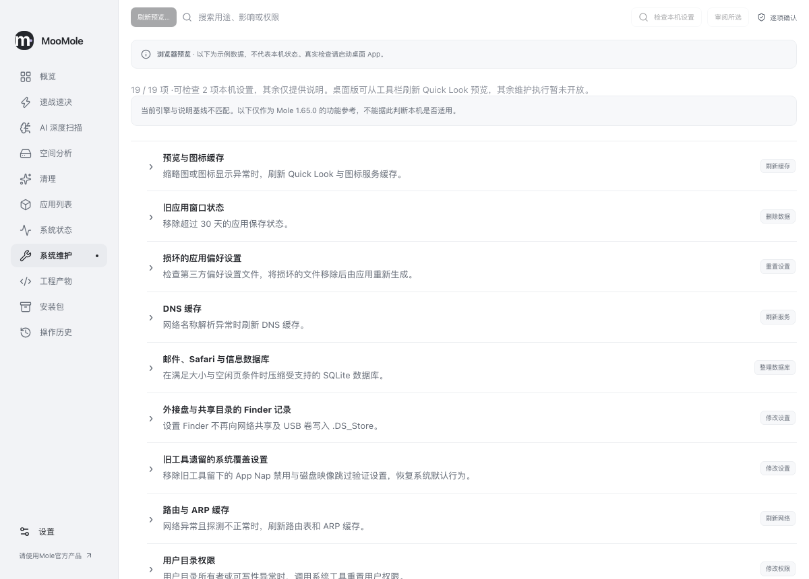
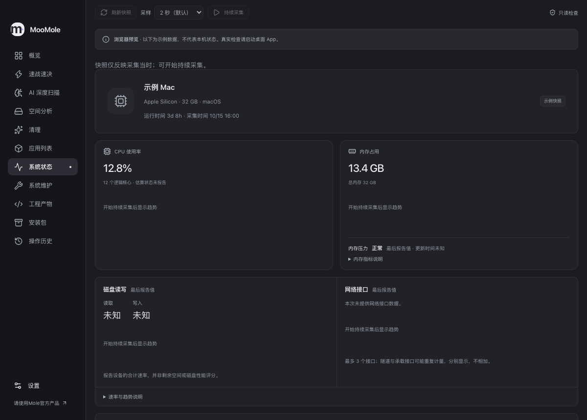

<p align="center">
  
</p>

<h1 align="center">MooMole</h1>

[English](README.md) · **简体中文** · [日本語](README.ja-JP.md)

Mole CLI 的非官方 macOS 可视化客户端，在 CLI 能力之上提供更人性化的使用流程。坚持简单直观：先看结果，再了解影响，最后明确操作。采用 React + Vite + TypeScript + Tauri + SQLite。

> 本项目仅供学习和研究使用，是独立的非官方项目。使用前请理解操作影响并备份重要数据，由此产生的问题与使用风险由使用者自行承担。
>
> 部分能力基于 [Mole CLI](https://github.com/tw93/Mole)，感谢原作者及贡献者。为尊重和支持 Mole 的开发成果，日常使用建议选择 [Mole 官方产品](https://mole.fit/zh/)。

## 界面预览

以下为当前简体中文界面的浏览器预览截图，使用示例数据，不代表本机扫描结果或发布验收。点击图片可查看原图。



| 空间分析 | 清理审阅 |
| --- | --- |
| [](docs/screenshots/space-analysis.png) | [](docs/screenshots/cleanup.png) |
| **系统维护** | **系统状态 · 深色主题** |
| [](docs/screenshots/maintenance.png) | [](docs/screenshots/system-status-dark.png) |

品牌资源：[SVG 图标](src/assets/icon.svg) · [横版 Logo](src/assets/logo.svg) · [深色背景 Logo](src/assets/logo-dark.svg)。使用方式见[品牌资源说明](docs/brand-assets.md)。

## 语言

界面支持简体中文、English 和日本語，可在“设置 → 通用 → 界面语言”随时切换，无需重启。首次启动跟随系统的首选语言；系统语言不属于中英日时使用英语。手动选择保存于本机，重新启动后继续生效，也可改回“跟随系统”。路径、原始日志和诊断证据保留原文；目前详细开发文档主要为中文。

## 当前状态

<!-- release:start -->

最新公开版本为 **[0.2.0](https://github.com/rememberber/MooMole/releases/tag/v0.2.0)**（2026-10-29），内置 **Mole CLI 1.65.0**。这是学习研究版本，已提供下表限定范围内的真实清理、应用卸载和 Quick Look 维护。完整权限/故障、安装升级及对应源码/许可验收仍未完成，具体见 [执行验收](docs/first-release-execution.md) 和发布说明。

0.2.0 新增速战速决与经过验证的用户缓存处理、本机 Agent 驱动的 AI 深度扫描、中英日免重启切换、窗口拖动修复及克制的任务动效。[发布说明](https://github.com/rememberber/MooMole/releases/tag/v0.2.0) 提供英、中、日三语。

<!-- release:end -->

| 功能             | 现在可以做什么                                                                                                              | 当前限制                                                                                                                                    |
| ---------------- | --------------------------------------------------------------------------------------------------------------------------- | ------------------------------------------------------------------------------------------------------------------------------------------- |
| 速战速决 / 清理  | 分类汇总缓存、日志、卸载残留、大文件和大应用；检查通过的帮助/图标缓存默认勾选，符合条件的用户缓存和普通日志可确认移入废纸篓 | 仅支持来源明确的用户缓存普通文件/严格目录和普通日志；残留与个人大文件执行未开放，未知、变化或过期保留；见 [速战速决](docs/quick-cleanup.md) |
| AI 深度扫描      | 检测本机 Agent，使用内置 Skill 结合 Mole 候选、所选目录元数据和模型知识给出逐项建议，再进入原有清理审阅                     | 首批适配 Codex CLI / Claude Code（Claude 需 API/云服务凭据，尚未实测）；需确认模型数据使用及额度，扩展线索仅供核实；见 [AI 扫描](docs/ai-deep-scan.md)     |
| 应用列表         | 搜索和查看应用、运行/关联线索；单个受支持普通 App 包可确认移入废纸篓                                                        | 包外设置、缓存和个人数据保留；运行、受保护、受管理或条件未知时保留，不承诺清除全部残留                                                      |
| 系统维护         | 查阅固定 Mole 的 19 项说明；明确选择并执行 Quick Look 缩略图缓存、生成器列表两步刷新                                        | 其余维护只读；无原缓存备份或一键撤销，不承诺修复或提速                                                                                      |
| 空间分析         | 选择目录、空间图/列表、目录下钻、可点击路径、大文件筛选和 Finder 定位                                                       | 不删除文件；测量大小不代表可释放空间，部分结果保留不完整提示                                                                                |
| 系统状态         | 快照、可暂停的持续采集、CPU/内存/磁盘/网络趋势及可用指标                                                                    | 指标缺失或过期会明确说明；离开页面停止持续采集                                                                                              |
| 工程产物与安装包 | 明确选择范围，发现、测量、筛选和只读检查                                                                                    | 尚不提供清理；未发现占用不构成可处理证明                                                                                                    |
| 操作历史         | 查看逐项结果、收据、中断及待核实状态；核查后保留原事实；完整归档、导出和只读打开                                            | 不从历史重新执行；没有应用内自动恢复，归档文件仍占磁盘空间                                                                                  |

第一次使用见 [使用说明](docs/first-use.md)。完整能力映射和后续开发范围见 [产品方向](docs/product-direction.md) 与 [发布路线图](docs/release-roadmap.md)。首页显著展示实际内置 Mole CLI 版本及引擎状态；浏览器预览只展示示例数据。

移入废纸篓不等于立即释放空间。取消只停止尚未开始的操作，已发生的结果继续保留；遇到待核实结果，不自动重试。需要取回时，在 Finder 核对真实对象与原目录，避免覆盖现有文件。客户端保护和 Mole 的白名单仍然生效，不为取得成功结果而放宽未知或受限条件。

## 安装与更新

<!-- downloads:start -->

可从下方下载与本机架构匹配的 **0.2.0** DMG。安装包采用免费 ad-hoc 签名，没有 Apple Developer ID 签名或公证，不要求购买 Apple 开发者账户。

| Mac 类型 | 下载 |
| --- | --- |
| Apple 芯片（`arm64`） | [MooMole 0.2.0 DMG](https://github.com/rememberber/MooMole/releases/download/v0.2.0/MooMole-0.2.0-mac-arm64.dmg) |
| Intel（`x64`） | [MooMole 0.2.0 DMG](https://github.com/rememberber/MooMole/releases/download/v0.2.0/MooMole-0.2.0-mac-x64.dmg) |

可在[关于本机](https://support.apple.com/zh-cn/guide/mac-help/mchlea7173f3/mac)查看芯片或处理器。核对[发布页](https://github.com/rememberber/MooMole/releases/tag/v0.2.0)或 [SHA512SUMS](https://github.com/rememberber/MooMole/releases/download/v0.2.0/SHA512SUMS) 中的大小和 SHA-512，再打开 DMG，将应用复制到“应用程序”并从安装位置启动。对应架构的 `materials.zip` 包含匹配的源码、依赖材料和校验清单。

<!-- downloads:end -->

首次打开时，macOS 可能提示无法验证开发者或检查恶意软件；请先确认来源和文件完整性，再根据 [Apple 的安全说明](https://support.apple.com/zh-cn/102445)自行判断。应用不会关闭 Gatekeeper 或移除系统安全属性。更新采用“设置 → 关于 → 检查更新 → 下载并校验大小/SHA-512 → 打开 DMG → 正常退出后手动替换”的流程，不静默覆盖运行中的 App。没有已发布新版时，更新检查不会生成安装包。

0.2.0 安装包已通过 macOS arm64/x64 自动化检查、嵌套签名与资源校验、DMG 挂载及公开下载摘要复核，见 [本版发布验证记录](docs/releases/0.2.0.md)。Intel 原生交互、公开隔离下载后的首次打开、跨版本安装/权限行为及完整支持环境验收仍待完成，见 [安装升级方案](docs/distribution.md)。

## 本地开发

构建目标为 macOS 14+；当前实际原生交互验收主要在 Apple Silicon 开发机完成，不能将构建目标当作最低系统或 Intel 使用验收已通过。

需要 Node.js 24+、npm、Rust、Go 和 Xcode Command Line Tools。固定工具链版本见 [构建检查](docs/build-validation.md)；脚本优先识别项目 `.cache/` 中的工具链，不修改 shell 配置。新克隆仍需自行准备工具。

```sh
npm ci
npm run engine:prepare
npm run desktop

# 仅浏览器示例，不读取本机数据
npm run dev

# 生成本地优化 App、ZIP、校验报告；不上传或公开发布
npm run build:local-app

# 另生成、挂载核对并推出架构匹配的免费 ad-hoc DMG
npm run build:local-dmg
```

引擎来自固定 Git 树，构建后校验资源/架构并原子发布；失败保留旧引擎。已有对应缓存时，可向准备/本地产物命令追加 `-- --offline`。运行 App 不依赖开发工具链，也不下载或单独更新内置引擎。详细配方见 [引擎准备](docs/engine-integrity.md) 和 [本地产物](docs/local-app-build.md)。

## 检查

只编辑 `package.json` 中的应用版本，再运行 `npm run version:sync` 同步原生和锁文件。常用检查：

```sh
npm run version:check
npm run format:check
npm test
npm run build
npm run notices:prepare # 原生构建前准备许可材料，Tauri 包装入口会自动执行
npm run check:rust
npm run test:engine
npm run test:adapter
npx playwright install chromium
npm run test:e2e
```

浏览器回归使用独立的 1431 端口，不复用已有服务；冲突时可显式设置 `MOOMOLE_E2E_PORT=1432`。开发 App 使用 1420。其余版本、产物、来源、许可和候选工具的检查见 [构建验证](docs/build-validation.md)。日常 Checks 与发布独立。与 MooTool 一致，推送版本标签后并行打包、自动发布三语 GitHub Release，再更新清单与 README 下载区块，见 [发布约定](RELEASE_CONVENTIONS.md)。

## 本地数据与恢复

设置与记录位于 `~/Library/Application Support/io.github.rememberber.moomole/`，数据库为 `moomole.sqlite`。记录可能包含路径、检查结果、操作意图和废纸篓收据，不保存文件正文或管理员密码。AI 深度扫描需另行确认后将有界文件元数据交给所选 Agent 的模型服务；其他记录不自动上传。

任务、扫描和审阅记录默认保留 30 天，可选 7/90 天。执行凭证及未核查中断证据不随普通历史直接清除；三模块共用修改准入和活动记录上限。容量不足时停止新批次，可在“操作历史 → 归档…”完整保存已结束且必要核查完成的执行记录，再释放其活动容量。归档保留原计划、逐项结果、收据、事件和核查，支持导出及只读打开，不恢复执行许可。详情见 [本地记录保留](docs/local-data-retention.md) 与 [执行归档](docs/execution-archive.md)。

当前数据库 schema 为 v7；从 v1–v6 升级前自动备份，旧版 App 不应直接打开新库。中断后不会自动继续修改，待核实结果须先核对实际对象再记录核查，原未知结果不改写。没有一键回滚数据库或统一撤销操作；详见 [升级与恢复](docs/native-upgrade-recovery.md)。

前端没有通用 Shell、任意 SQL 或直接文件访问接口。修改经独立日志、卸载或 Quick Look 确认与当次验证入口。更新仅访问固定来源，不附带目录、历史或诊断，见 [更新隐私与协议](docs/update-check.md)。只读检查可能写入本地缓存/检查记录，不表示完全没有本地写入。

## 来源与许可证

内置 Mole CLI 基线为 **1.65.0** / [`308bf9911179ddfa40e5df9fdc42095a18ba5cfc`](https://github.com/tw93/Mole/commit/308bf9911179ddfa40e5df9fdc42095a18ba5cfc)，上游源码未修改。客户端适配层和界面源码在本仓库。发布材料提供绑定同一 App 的客户端、Mole、依赖分发物及 npm 源码输入，完整对应源码与发行许可审阅仍待完成，见 [源码包](docs/source-bundle.md) 和 [依赖材料](docs/dependency-materials.md)。

本项目按 [GPL-3.0-only](LICENSE) 提供。上游许可证见 [Mole-LICENSE](third-party/Mole-LICENSE)，来源和构建说明见 [第三方说明](third-party/NOTICE.md)。Mole 名称及品牌资产属于原项目，本项目不代表官方或获得官方背书；公开名称仍须按上游品牌政策确认。
