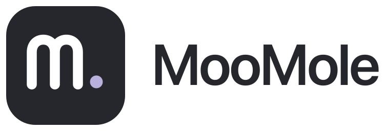

# 品牌资源

MooMole 的品牌图标与横版 Logo 均提供 SVG 源文件，可用于 README、网站、介绍材料和后续客户端界面。沿用现有的深灰圆角底、白色 `m` 与淡紫色圆点，不改变当前 App 图标。

| 资源              | 文件                                         | 使用场景                                            |
| ----------------- | -------------------------------------------- | --------------------------------------------------- |
| 独立图标          | [icon.svg](../src/assets/icon.svg)           | 应用标识、头像、小尺寸图标；`viewBox="0 0 512 512"` |
| 横版 Logo         | [logo.svg](../src/assets/logo.svg)           | 浅色背景下的图标与 MooMole 名称组合                 |
| 深色背景横版 Logo | [logo-dark.svg](../src/assets/logo-dark.svg) | 深色背景；名称使用浅色，图标保持原色                |



所有 SVG 均为透明背景、纯矢量内容，无嵌入位图或外部资源。横版 Logo 的名称已转为路径，显示时不依赖本机字体。深色背景版本不包含背景色，预览时需放在深色底上。

保持原始宽高比，不拉伸、不裁切图标的外部留白。建议图标显示不小于 24 × 24 px，横版 Logo 宽度不小于 180 px；通过 `width` 配合自动高度缩放即可。

```html


```

品牌颜色：深灰 `#25272c`、白色 `#ffffff`、淡紫 `#b9b0dd`；深色背景 Logo 名称为 `#f5f5f7`。

`src-tauri/icons/` 中的 PNG、ICNS、ICO 是桌面打包资源，SVG 图标源文件位于 `src/assets/icon.svg`。只有调整应用图标时才需要重新生成打包资源：

```sh
npm run tauri -- icon src/assets/icon.svg
```

横版 Logo 与独立图标共享同一图形；调整品牌图形时，应同步更新两份横版文件中的图标部分。客户端侧栏和关于页目前仍用文字与 CSS 绘制标识，并未自动引用这些 SVG。

这些素材用于标识 MooMole 这一独立、非官方项目，不代表 Mole 官方品牌或背书。上游来源、致谢、官方入口及品牌命名状态以 [README](../README.zh-CN.md) 和 [第三方说明](../third-party/NOTICE.md) 为准。
